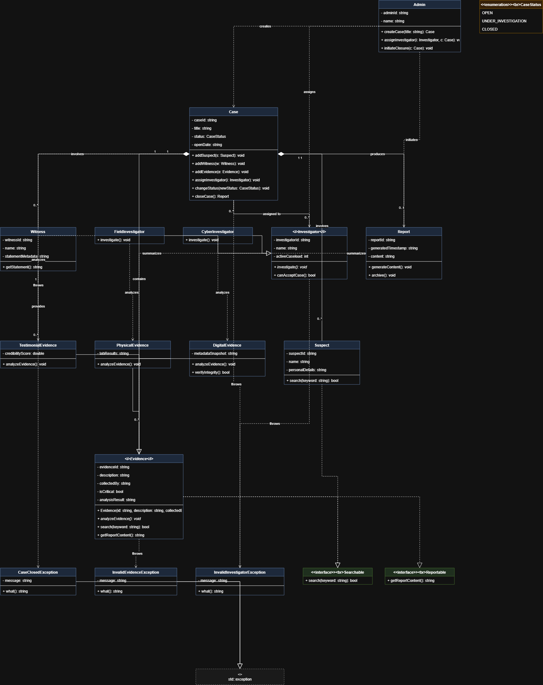
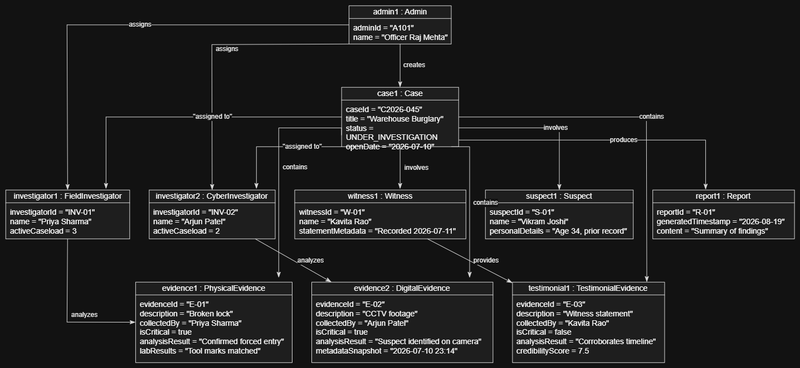
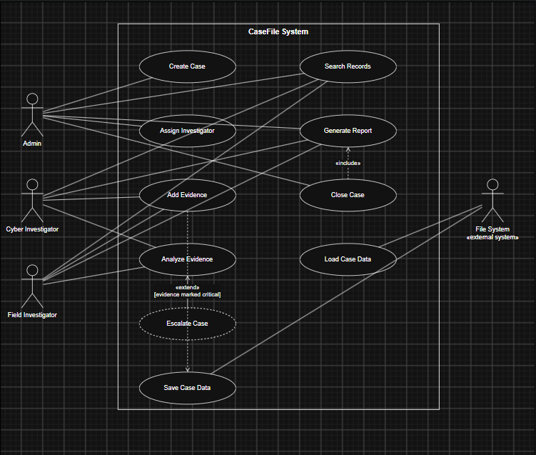

<div align="center">

# 🕵️ CaseFile

### Digital Crime Investigation Simulator

A console-based case management system that models cases, suspects, witnesses, evidence and investigators, with the investigation workflow enforced by the class design itself.


-blueviolet)

</div>

---

## Table of contents
- [About](#about)
- [Features](#features)
- [Design at a glance](#design-at-a-glance)
- [OOP concepts demonstrated](#oop-concepts-demonstrated)
- [Getting started](#getting-started)
- [Usage](#usage)
- [Project structure](#project-structure)
- [Documentation](#documentation)
- [Known issues](#known-issues)
- [Team](#team)

## About

Investigations involve many linked entities, each with different behavior and strict rules: a closed case must not change, digital and physical evidence are analysed differently, and an investigator can only juggle so many cases. A procedural program ends up as a pile of `if (type == …)` branches.

CaseFile models the domain with classes instead. Adding a new evidence type or investigator specialization means **adding a class**, not editing existing logic. Invalid operations raise **specific custom exceptions** rather than failing silently.

> Built as a group project for the Object-Oriented Programming course (Semester III, IIIT Vadodara). Full problem framing: [`problem-statement.md`](problem-statement.md).

## Features

- **Case lifecycle** — `OPEN → UNDER_INVESTIGATION → CLOSED`, with validated transitions; a closed case rejects every change.
- **Polymorphic evidence** — Digital, Physical and Testimonial evidence, each with its own analysis and integrity-failure message.
- **Investigator specializations** — Cyber and Field investigators follow different `investigate()` procedures; max caseload of 5.
- **Suspects and witnesses** — recorded per case.
- **Integrity checks** — each evidence item carries a djb2 checksum that can be re-verified.
- **Keyword search** across case titles, suspects, witnesses and evidence.
- **Report generation** — formatted case report, preceded by the assigned investigator's procedure.
- **Save / load** — plain-text persistence in `cases.txt`, rebuilding the right evidence subclass on load.
- **Typed errors** — `CaseClosedException`, `InvalidEvidenceException`, `InvalidInvestigatorException`.

Out of scope: GUI, database backend, multi-user login.

## Design at a glance



```
Evidence (abstract)                 Investigator (abstract)
 ├── DigitalEvidence                 ├── CyberInvestigator
 ├── PhysicalEvidence                └── FieldInvestigator
 └── TestimonialEvidence

Case ── owns ──► vector<unique_ptr<Evidence>>
     ── holds ─► Suspect, Witness
     ── refs ──► shared_ptr<Investigator>
```

<details>
<summary><b>Object diagram</b> — a runtime snapshot of the demo session</summary>



</details>

<details>
<summary><b>Use case diagram</b> — what the console user can do</summary>



</details>

## OOP concepts demonstrated

| Concept | Where | How |
|---|---|---|
| **Abstraction** | `Evidence`, `Investigator` (`src/Evidence.h`, `src/Investigator.h`) | Pure virtual `typeSpecificAnalysis()`, `verifyIntegrity()`, `getReportContent()`, `investigate()`; base classes cannot be instantiated |
| **Inheritance** | 3 evidence subclasses, 2 investigator subclasses | Subclasses add their own state (`metadataSnapshot_`, `labResults_`, `credibilityScore_`) |
| **Polymorphism** | `Case::analyzeAllEvidence()` | One loop over `vector<unique_ptr<Evidence>>`; no `switch` on type |
| **Template Method** | `Evidence::analyzeEvidence()` | Public non-virtual entry point calls the private virtual hook, then sets `analyzed_` |
| **Encapsulation** | `Case::requireOpen()` | Status is private; the closed-case guard lives inside the class, so the UI cannot bypass it |
| **Exception handling** | `src/Exceptions.h` | Three typed exceptions derived from `std::exception`, caught in the menu layer |
| **Operator overloading** | `Case::operator==`, `Case::operator+=`, `operator<<(Report)` | Compare cases by ID, add evidence, print a report |
| **Smart pointers / STL** | `unique_ptr`, `shared_ptr`, `map`, `vector` | Evidence ownership, shared investigators, keyed case lookup |
| **Virtual destructor** | `Evidence`, `Investigator` | Safe deletion through base pointers |

## Getting started

### Prerequisites
- A C++17 compiler (g++ 9+, clang 10+, or MSVC 2019+)
- CMake 3.10+ *(optional)*

### Build

```bash
# Option 1 — plain g++
g++ -std=c++17 -Wall -Wextra src/*.cpp -o casefile

# Option 2 — CMake
cmake -S . -B build
cmake --build build
```

### Run

```bash
./casefile            # Linux / macOS (or ./build/casefile with CMake)
casefile.exe          # Windows
```

Cases are saved to `cases.txt` (menu option 13) and loaded automatically at startup.

## Usage

```
 1. Create New Case              8. View All Cases
 2. Add Suspect / Witness        9. Close Case
 3. Add Evidence                10. Search
 4. Analyze Evidence            11. Register Investigator
 5. Verify Evidence Integrity   12. Remove Evidence
 6. Assign Investigator         13. Save to file
 7. Generate Case Report        14. Load from file
                                 0. Exit
```

### Quick demo

Feed the bundled script to the program:

```bash
./casefile < demo-input.txt
```

It performs: create case **"Art Heist"** → add Digital evidence → register Field investigator **Detective Rao** → assign → analyze → report → close → save.

Sample output (trimmed):

```
  Created case CASE-1 — "Art Heist"
  Evidence EVID-1000 (Digital) added to case CASE-1.
  Registered Detective Rao as Field investigator.
  Investigator "Detective Rao" assigned to case CASE-1. Status -> UNDER_INVESTIGATION.
  >> [DIGITAL] Scanning metadata snapshot (16 bytes) …
  >> File-system artifacts cross-referenced.
  [Evidence EVID-1000] Analysis complete.
  [Field Investigator Detective Rao] Initiating on-site procedure:
    1. Securing the crime scene perimeter …
    …
  Case CASE-1 has been CLOSED.
  Saved 1 case(s) to cases.txt.
```

### Error handling in action

```
Add evidence to a closed case   →  ✖ Case CASE-1 is already CLOSED — operation rejected.
Assign a 6th case to one person →  ✖ Invalid investigator: <name> has reached maximum caseload.
Evidence with empty description →  Description and collector are required.
```

## Project structure

```
.
├── README.md
├── problem-statement.md
├── CMakeLists.txt
├── demo-input.txt               # scripted demo session
├── cases.txt                    # runtime save data (gitignored)
├── docs/
│   ├── PRD.md                   # product requirements
│   ├── class-diagram.png / .puml
│   ├── object-diagram.png / .puml
│   ├── use-case-diagram.png / .puml
│   ├── crc-cards.md
│   └── noun-analysis.md
└── src/
    ├── Exceptions.h             # custom exception hierarchy
    ├── Person.h                 # Suspect, Witness
    ├── Evidence.h / .cpp        # abstract Evidence + 3 subclasses
    ├── Investigator.h / .cpp    # abstract Investigator + 2 subclasses
    ├── Case.h / .cpp            # lifecycle, guards, polymorphic traversal
    ├── Report.h / .cpp          # report packaging & serialization
    └── main.cpp                 # console menu, containers, save/load
```

## Documentation

| Document | Contents |
|---|---|
| [`problem-statement.md`](problem-statement.md) | Background, problem, objectives, scope |
| [`docs/PRD.md`](docs/PRD.md) | Requirements, business rules, acceptance criteria, known issues, roadmap |
| [`docs/class-diagram.png`](docs/class-diagram.png) | Static structure (source: `.puml`) |
| [`docs/object-diagram.png`](docs/object-diagram.png) | Example runtime snapshot |
| [`docs/use-case-diagram.png`](docs/use-case-diagram.png) | Actors and use cases |
| [`docs/crc-cards.md`](docs/crc-cards.md) | Class–Responsibility–Collaborator cards |
| [`docs/noun-analysis.md`](docs/noun-analysis.md) | Noun–verb analysis that produced the class list |

Diagram sources are [PlantUML](https://plantuml.com); regenerate with `java -jar plantuml.jar -tpng docs/*.puml`.

## Known issues

Current limitations are tracked in [`docs/PRD.md` §11](docs/PRD.md#11-known-issues-and-gaps). The ones to know before using it:

- **Reloading a saved *closed* case that has evidence, suspects or witnesses crashes at startup** (the loader closes the case before refilling it).
- Evidence and person ID counters restart on every launch, so IDs can repeat after a load.
- Investigators and their assignments are not saved.
- The demo date is hardcoded.

## Team

| Name | GitHub | Role |
|---|---|---|
| Umang Modi | [`modiumang2007-cmyk`](https://github.com/modiumang2007-cmyk) | Team leader |
| Riya Vasoya | | Team member |
| Vedant Songire | | Team member |
| Pratyush Pandit | | Team member |
| Kunal Patni | | Team member |

---

<div align="center">
<sub>Built with C++17 · No external dependencies</sub>
</div>
